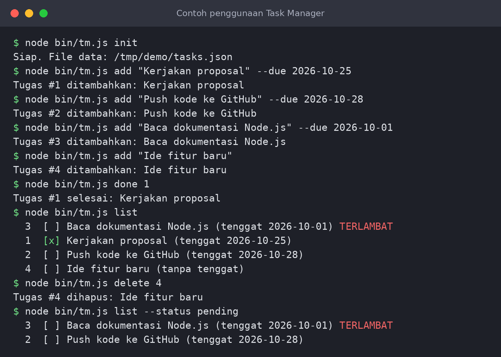
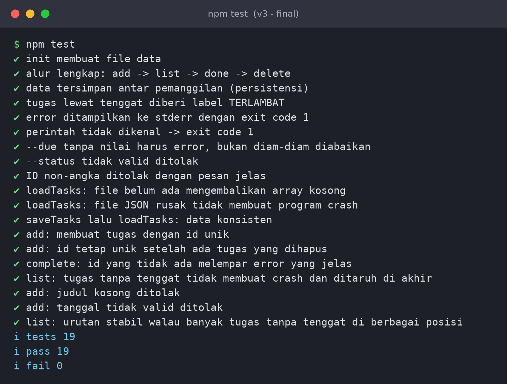

# Task Manager JS

Aplikasi **task manager berbasis terminal (CLI)** yang ditulis dengan JavaScript (Node.js),
dikembangkan dengan bantuan **AI generatif** sebagai asisten pemrograman. Tanpa dependensi
eksternal: cukup Node.js.

> Dokumen lengkap proses pengembangan (analisis -> perancangan -> prompt ke AI -> evaluasi kode ->
> pengujian -> debugging -> perbaikan) ada di
> [`docs/Proposal_Task_Manager_JS.docx`](docs/Proposal_Task_Manager_JS.docx)
> (versi PDF: [`docs/Proposal_Task_Manager_JS.pdf`](docs/Proposal_Task_Manager_JS.pdf)).



## Fitur

- Tambah tugas dengan judul dan tenggat opsional (`YYYY-MM-DD`)
- Lihat daftar tugas, filter `all` / `pending` / `done`, diurutkan menurut tenggat terdekat
- Tandai tugas selesai, hapus tugas
- Penanda **TERLAMBAT** untuk tugas yang lewat tenggat
- Validasi input (judul kosong, tanggal tidak ada di kalender, opsi tanpa nilai)
- Data tersimpan di file JSON; file rusak otomatis dibackup ke `.bak`
- 19 tes otomatis (`node:test`)

## Prasyarat

| Kebutuhan | Versi |
|-----------|-------|
| Node.js   | 20 atau lebih baru (dikembangkan & diuji di Node 22) |
| Git       | untuk clone repositori |

Cek versi: `node -v`

## Instalasi

```bash
git clone https://github.com/<username-anda>/task-manager-js.git
cd task-manager-js
# Tidak perlu "npm install" - proyek ini tidak memakai library eksternal.
```

## Inisialisasi

Jalankan sekali untuk membuat file data (`data/tasks.json`):

```bash
npm run init
# atau
node bin/tm.js init
```

Opsional - pasang perintah `tm` secara global agar tidak perlu mengetik `node bin/tm.js`:

```bash
npm link
tm help
```

## Konfigurasi

Prioritas konfigurasi (tinggi -> rendah):

1. **Variabel lingkungan**
2. **`config/default.json`**

| Pengaturan | `config/default.json` | Variabel lingkungan | Keterangan |
|------------|-----------------------|---------------------|------------|
| Lokasi file data | `"dataFile": "data/tasks.json"` | `TM_DATA_FILE` | Path relatif dihitung dari root proyek |
| Warna keluaran   | `"color": true`                 | `NO_COLOR=1`   | Matikan warna ANSI |

Contoh memakai file data lain:

```bash
# Linux / macOS
TM_DATA_FILE=/tmp/tugas-kuliah.json node bin/tm.js list

# Windows PowerShell
$env:TM_DATA_FILE="C:\temp\tugas-kuliah.json"; node bin/tm.js list
```

## Cara menjalankan

```bash
node bin/tm.js <perintah> [argumen]      # atau: npm start -- <perintah>
```

| Perintah | Fungsi | Contoh |
|----------|--------|--------|
| `init` | Siapkan file data | `node bin/tm.js init` |
| `add "<judul>" [--due YYYY-MM-DD]` | Tambah tugas | `node bin/tm.js add "Belajar JS" --due 2026-11-01` |
| `list [--status all\|pending\|done]` | Tampilkan tugas | `node bin/tm.js list --status pending` |
| `done <id>` | Tandai selesai | `node bin/tm.js done 1` |
| `delete <id>` | Hapus tugas | `node bin/tm.js delete 1` |
| `help` | Bantuan | `node bin/tm.js help` |

Kode keluar (exit code): `0` jika sukses, `1` jika terjadi error (pesan error ke stderr).

## Menjalankan tes

```bash
npm test
```

Hasil yang diharapkan: `tests 19`, `pass 19`, `fail 0`.



## Struktur proyek

```
task-manager-js/
├── bin/tm.js               # titik masuk CLI
├── src/
│   ├── cli.js              # parsing argumen & format keluaran
│   ├── taskManager.js      # logika bisnis (tanpa I/O)
│   ├── validators.js       # validasi judul & tanggal
│   ├── storage.js          # baca/tulis JSON (atomik, tahan file rusak)
│   └── config.js           # pemuatan konfigurasi
├── config/default.json     # konfigurasi bawaan
├── data/                   # lokasi tasks.json (tidak di-commit)
├── test/                   # tes unit & end-to-end
├── docs/                   # proposal, gambar, bukti pengujian, skrip pembuat gambar
└── .github/workflows/ci.yml
```

## Pengembangan dengan AI - ringkasan

Setiap iterasi tercatat di riwayat git (`git log --oneline`):

1. **v1** - draf awal dari AI + tes. Hasil: 7 dari 10 tes **gagal** (bug nyata).
2. **v2** - perbaikan ID duplikat, error handling, pengurutan, storage, validasi. Semua tes inti lulus.
3. **v3** - tes end-to-end CLI menemukan bug baru (`--due` tanpa nilai); diperbaiki. 19/19 lulus.

Bukti keluaran tes tiap iterasi ada di [`docs/evidence/`](docs/evidence). Gambar proposal dapat dibuat
ulang dengan `python3 docs/make_figures.py` (membutuhkan Pillow & matplotlib).

## Troubleshooting

| Masalah | Penyebab / solusi |
|---------|-------------------|
| `Cannot find module` saat `npm test` | Pastikan Node >= 20 dan jalankan dari root proyek |
| `Error: Tugas dengan ID n tidak ditemukan` | Cek ID lewat `node bin/tm.js list` |
| File data rusak | Otomatis disalin ke `tasks.json.bak`, lalu dimulai dari daftar kosong |
| Warna tampil aneh di terminal | Set `NO_COLOR=1` |

## Mengunggah ke GitHub

```bash
git remote add origin https://github.com/<username-anda>/task-manager-js.git
git push -u origin main
```

## Lisensi

MIT - lihat [LICENSE](LICENSE).
